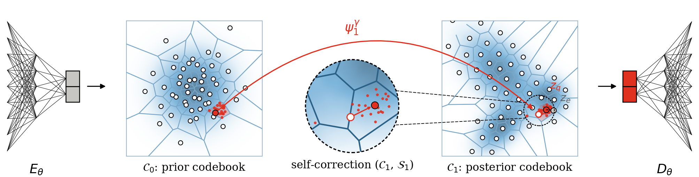

# FlowVQ

Official implementation of **Transporting Quantiles to Codebook: Scalable Vector Quantization without Codebook Collapse** (NeurIPS 2026).

FlowVQ learns the codebook with a flow-matching model that transports a Gaussian onto the encoder
latents: the codebook is obtained by pushing a quasi-random (Sobol) grid of Gaussian quantiles through
the flow, so every code stays in use.



## Repository structure

| Paper section | Task | Folder |
|---|---|---|
| 4.1 | CIFAR-10 and ImageNet-1K tokenization, ImageNet-1K generation | [`image_tasks`](image_tasks) |
| 4.2.1 | Crystalline material tokenization (MP-20) | [`high_precision_tasks/material_tokenization`](high_precision_tasks/material_tokenization) |
| 4.2.2 | Robot action tokenization (DROID) | [`high_precision_tasks/action_tokenization`](high_precision_tasks/action_tokenization) |
| – | Minimal example: MNIST tokenization | [`mnist_example.ipynb`](mnist_example.ipynb) |

Each task has its own environment and a README with the full instructions, including the baselines.

## Clone

```bash
# image tasks only
git clone https://github.com/friolero/FlowVQ.git

# image and high-precision tasks (material and action tokenization are git submodules)
git clone --recursive https://github.com/friolero/FlowVQ.git
```

To add the high-precision tasks to an existing clone, run `git submodule update --init --recursive`.
The submodules are pinned to the code used in the paper; to get their latest `main` instead, run
`git submodule update --init --remote`.

## Image tasks (Sec. 4.1)

See [`image_tasks/README.md`](image_tasks/README.md) for the environment, the ImageNet-1K data
preparation and multi-node training. Tokenizer configs for FlowVQ and the baselines (VQGAN+, MaskBit,
OptVQ) are in `image_tasks/configs/{cifar10,imagenet}`. From `image_tasks/`:

```bash
# tokenizer
PYTHONPATH=./ WORKSPACE=./ accelerate launch scripts/train_tokenizer.py config=configs/cifar10/flow_tokenizer_cifar10_K1024Z10.yaml
# ImageNet-1K generation (MLM) on a trained tokenizer
PYTHONPATH=./ WORKSPACE=./ accelerate launch scripts/train_generation.py config=configs/imagenet/flow_mlm_imagenet_K16384Z14.yaml \
    experiment.vqgan_checkpoint=outputs/{RUN_NAME}/checkpoint-X/ema_model/pytorch_model.bin
```

Pretrained checkpoints are linked in the folder README.

## Crystalline material tokenization (Sec. 4.2.1)

See [`high_precision_tasks/material_tokenization/README.md`](high_precision_tasks/material_tokenization/README.md)
for the environment (PyTorch, PyG), the VQ-VAE / LFQ / OptVQ baselines and the pretrained auto-encoder.
The MP-20 data is included. FlowVQ training, from `high_precision_tasks/material_tokenization/`:

```bash
CUDA_VISIBLE_DEVICES=0 python3 main.py --conf_new model.flow=True model.optvq=False model.lfq=False model.flow_start_epoch=501
```

## Action tokenization (Sec. 4.2.2)

See [`high_precision_tasks/action_tokenization/README.md`](high_precision_tasks/action_tokenization/README.md)
for the environment and the DROID data. From `high_precision_tasks/action_tokenization/`:

```bash
python main.py                      # FlowVQ
python main.py --quantizer kmeans   # k-means initialized VQ-VAE baseline
python eval.py output/<run_name>/model_e<epoch>.pt   # reconstruction MSE and codebook usage
```

## Minimal example: MNIST tokenization

[`mnist_example.ipynb`](mnist_example.ipynb) trains a small VQ-VAE with a FlowVQ codebook and a
standard VQ-VAE baseline on MNIST, then compares reconstruction error, codebook usage and t-SNE plots of
the codebooks. It uses `flowvq.py` (the FlowVQ quantizer) and `viz_utils.py`, and is the best place to
start if you want to use FlowVQ in your own model.

- Colab: [](https://colab.research.google.com/github/friolero/FlowVQ/blob/main/mnist_example.ipynb) (select a GPU runtime, then run all cells).
- Locally: `pip install -r requirements.txt jupyter && jupyter notebook mnist_example.ipynb`.
